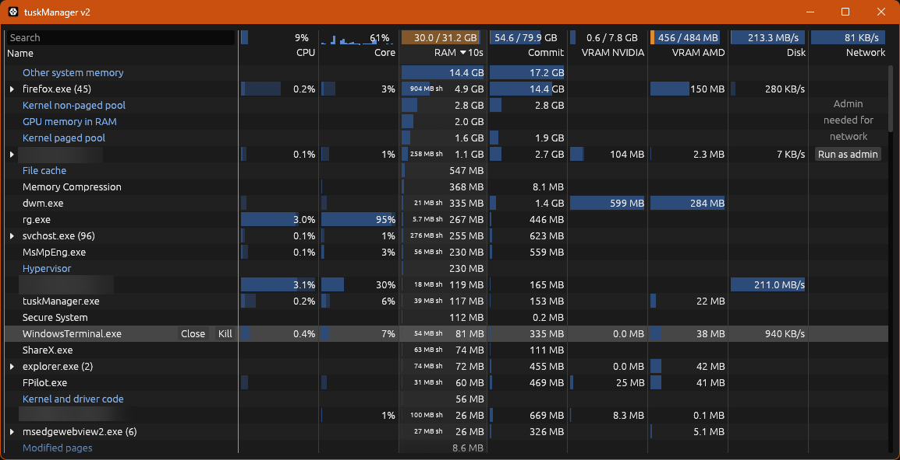

# tuskManager

Simple replacement for Task Manager that suits a very particular set of needs (mine):

 - Show single-core bottlenecks
 - Non-process entries eating ram
 - Faster close/kill access
 - Per-gpu vram use
 - Sorting by last-10-seconds peak
 - Few more small details

Use `run.bat` to compile+launch, or download the exe file from Releases.